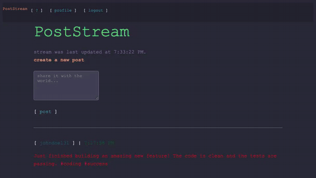

# PostStream

PostStream is an undesigned social network. It is a text-based response to the majority of modern social media platforms. This is certainly not for everyone as you will be interacting with others exclusively through text posts. You will notice several features intentionally left out in order to promote meaningful engagement. We hope you enjoy something a little different.

## Recording (November 2026)

What PostStream looked like in November 2026, recorded for [its page on joekarlsson.com](https://www.joekarlsson.com/work/poststream/). The full-quality video is [2026-11-recording.mp4](.github/readme/2026-11-recording.mp4).

## Text-Based Social Network

Tentative example post:

    [real name] [username] [time stamp]
    [post]

    Bill Atkinson billatkinson 2016.07.24 10:27:29
    I invented the double-click.

## Running it

You need [Docker](https://docs.docker.com/get-docker/), or Node.js 22+ and PostgreSQL.

### With Docker

    docker compose up --build

This builds the production bundle, runs migrations and seeds, and serves everything at [http://localhost:3002](http://localhost:3002).

### Local development

    npm install
    docker compose up -d postgres        # or point server/config/config.js at your own Postgres
    echo "JWT_SECRET=$(openssl rand -hex 32)" > .env
    npm run db:migrate
    npm run db:seed
    npm run dev

- Frontend (Vite, with hot reload): [http://localhost:3000](http://localhost:3000)
- API (Express): [http://localhost:3001](http://localhost:3001), proxied by Vite under `/post` and `/auth`

### Sample accounts

The seeders create three users, all with the password `password123`:

- `john@example.com` (johndoe131)
- `jane@example.com` (janedoe343)
- `joe@example.com` (joejoebinks131)

## Scripts

- `npm run dev`: Vite and the API together (the API restarts when server files change)
- `npm run build`: production build into `server/dist`
- `npm start`: serve the API and the built frontend (`NODE_ENV=production`, `PORT`, `DATABASE_URL`)
- `npm run lint` / `npm run type-check`
- `npm run db:migrate`, `npm run db:seed`, `npm run db:reset`

## Tests

All of these need the dev database, migrated and seeded. CI runs every one on each push.

- `npm test`: API and unit tests (`npm run test:coverage` adds a coverage report in `coverage/`)
- `npm run test:e2e`: Playwright on desktop Chrome, an iPhone (WebKit) and a Pixel: page smoke tests, user flows, axe accessibility checks, metadata, header alignment at 1280 and 2560px, phone widths and tap targets, links, and forced dark mode. Starts `npm run dev` if it isn't running
- `npm run test:visual`: screenshot tests against the production build. They run inside the pinned Playwright Docker image so the baselines match CI; add `-- --update-snapshots` after a deliberate design change
- Lighthouse runs in CI on the production build (`lighthouserc.json`): every category must score 90 or more on mobile, with a JavaScript budget of 140KB

## Stack

React 19, Redux Toolkit, React Router 7, Vite 8 and Sass modules on the front; Express 5, Sequelize 6, PostgreSQL and JWT auth (Passport) on the back.

## API

Routes marked *auth* need an `Authorization: Bearer <token>` header from `/auth/login` or `/auth/register`. Only the author can edit or delete a post or comment.

| Method | Path | |
|---|---|---|
| POST | `/auth/register` | `{ username, email, password, first_name, last_name, bio }` |
| POST | `/auth/login` | `{ email, password }`, returns `{ token, user }` |
| GET | `/auth/profile` | *auth*, the logged-in user |
| PUT | `/auth/profile` | *auth*, `{ first_name, last_name, bio }` |
| GET | `/auth/users` | everyone, by username (names only) |
| GET | `/auth/user/:username` | public profile, with follower and following usernames |
| GET | `/user/:username.txt` | a user's posts as plain text |
| POST / DELETE | `/auth/user/:username/follow` | *auth*, follow or unfollow |
| GET | `/post/feed` | *auth*, your feed: you and the people you follow, 10 at a time (`?offset=10` for more) |
| GET | `/post/user/:username` | a user's posts, 10 at a time (`?offset=`) |
| GET | `/post/:id` | one post |
| POST | `/post/new` | *auth*, `{ body }` (1 to 2048 characters) |
| PUT | `/post/:id/edit` | *auth*, `{ body }` |
| DELETE | `/post/:id` | *auth*, also deletes its comments |
| GET | `/post/:id/comments` | a post's comments, oldest first |
| POST | `/post/:id/comments/0/new` | *auth*, a contextual response: `{ kind, detail }` (see `shared/contextualResponses.mjs`) |
| PUT | `/post/:id/comments/:commentId/edit` | *auth*, `{ kind, detail }` |

## Important concepts

- No public metrics
  - No visible follower/following numbers
  - No visible like/dislike numbers
- No global public feed: your home page shows you and the people you follow; find people on `/people`
- No "moments" or news-related feeds
- No trending topics to browse
- Brevity: the stream shows the first 256 characters of a post, "read more" shows the rest (up to 2048)
- Accessibility
- No video/images/gifs (markdown image syntax renders as a plain link)
  - Unicode support 🆗
- Contextual responses instead of free-form replies
  - agree
  - agree, because $reason
  - disagree
  - disagree, because $reason
  - tell me more about $thought / $opinion
  - thank you for sharing
  - brilliant
- Plain text everywhere: every profile is also `/user/<name>.txt`, and every post has a permalink (`/p/<id>`)
- No ads or sponsored posts

## Stretch Goals

- Possible fuzzy metrics (Your engagement is {very high} {high} {average})
- SMS-support
- Filtering of topics
  - Mute options for keywords
  - Signup categories - subscribe to posts from only certain categories
  - Autofilter based on keywords, hashtags
- Keybase Verification
- Highlight text [medium.com]
- Permalinks - jump to comment or highlight
- Customize appearance
  - Theme support (Github, Solarized, Tomorrow, etc.)

## Inspiration

- [Little Voices](http://www.littlevoicesapp.com)
- [Rainbow Stream](http://www.rainbowstream.org)

## Contributing

1. Fork it
2. Create your feature branch: `git checkout -b my-new-feature`
3. Commit your changes: `git commit -am 'Add some feature'`
4. Push to the branch: `git push origin my-new-feature`
5. Open a pull request

## Credits

- Ray Farias
- Jacoby Young
- Joe Karlsson
